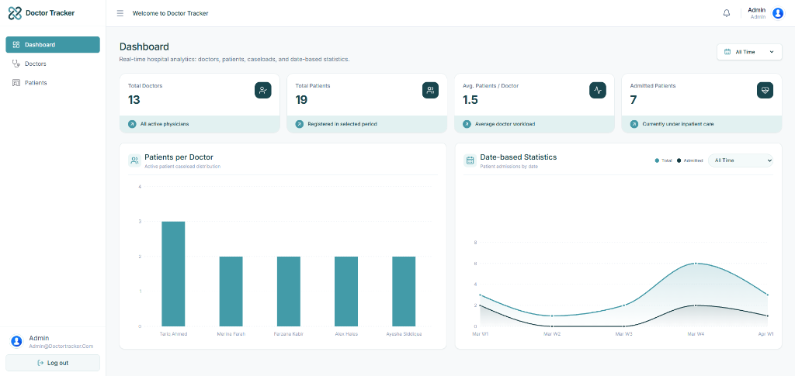
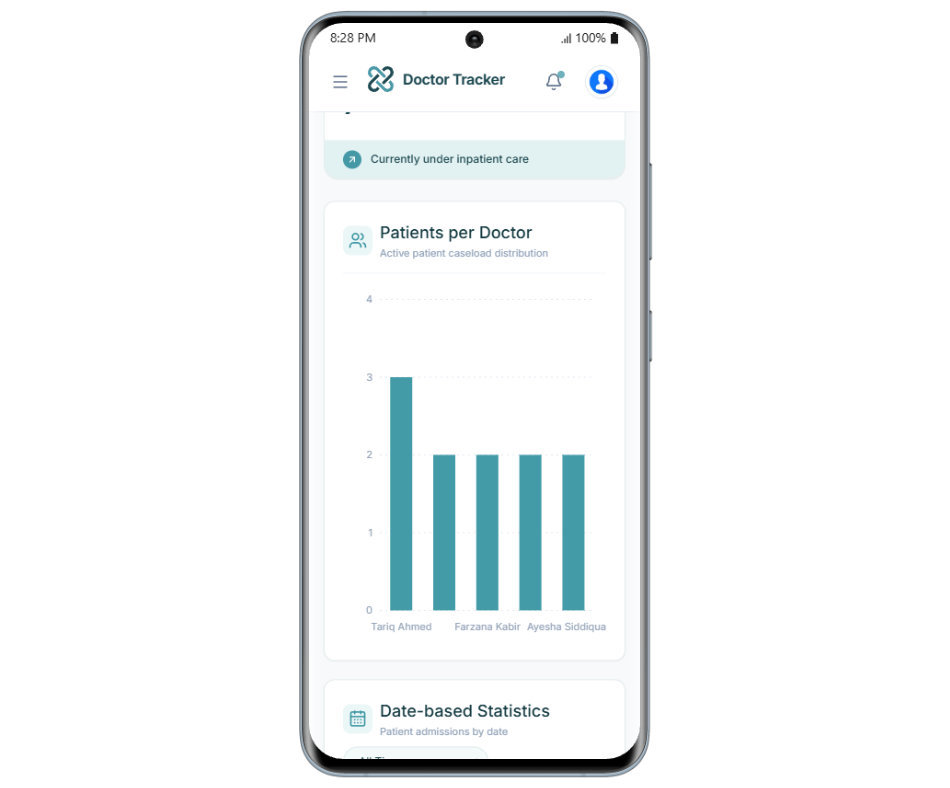

# &nbsp;&nbsp;Doctor Tracker Dashboard

**Welcome to Doctor Tracker – Hospital Doctor & Patient Management System** — a modern, responsive healthcare administration platform designed to streamline doctor profiles, patient records, physician-patient assignments, and real-time hospital analytics.

## 🔗 Live Links
- **Live Frontend**: https://doctor-tracker-zone.vercel.app

## 📸 Visual Evidence (Desktop & Mobile Views)

<table>
  <tr>
    <th align="center">Desktop — Admin Dashboard</th>
    <th align="center">Mobile — Responsive Dashboard</th>
  </tr>
  <tr>
    <td align="center" width="64%">
      
    </td>
    <td align="center" width="36%">
      
    </td>
  </tr>
</table>

<details>
<summary><strong>Desktop — Login View</strong></summary>
<br />

</details>


## ✨ Features Implemented

### 1. Dashboard & Data Visualization
- **Live KPI Metrics**: Displays real-time **Total Doctors**, **Total Patients**, **Avg. Patients / Doctor**, and **Admitted Patients** with date-range filtering (`All Time`, `Today`, `Last 7 Days`, `Last 30 Days`, `This Year`).
- **Patients per Doctor Chart**: Interactive bar chart visualizing active patient caseload distribution across doctors.
- **Date-based Statistics Chart**: Smooth dual-area trend chart tracking total patient registrations and inpatient admissions over time.
- **Layout-Matched Skeleton Loaders**: Smooth skeleton loading placeholders matching the exact card, chart, and table layouts.

### 2. Authentication & Route Protection
- **JWT-Based Login**: Secure admin authentication with Redux Toolkit state management and cookie-based Next.js middleware route protection.
- **Demo Credentials Helper**: One-click auto-fill button on the login screen for quick evaluation.

### 3. Doctor Management
- **Full CRUD**: Create, view, edit, and delete doctor profiles with specialty, hospital, contact details, duty status (`Active` / `Inactive`), and profile photo upload.
- **Doctor Detail View**: Dedicated `/doctors/[doctorId]` page showing the physician's full profile, assigned patient count, and an interactive table to assign or remove patients directly.
- **Search, Filter & Pagination**: Real-time debounced search, specialization filtering, and server-backed pagination.

### 4. Patient Management
- **Full CRUD**: Register, inspect, update, and delete patient records with demographics, medical condition, assigned doctor, admission date, status (`Admitted`, `Followup`, `Discharged`, `Transferred`), and profile image support.
- **Patient Detail View**: Dedicated `/patients/[patientId]` page with Clinical & Admission Summary and Assigned Physician card with direct navigation to the doctor's profile.

## 🛠️ Tech Stack
- **Next.js 16** (App Router, Turbopack)
- **React 19** (UI Library)
- **TypeScript** (Type Safety)
- **Redux Toolkit & RTK Query** (State Management & API Caching)
- **React Hook Form & Zod** (Form Handling & Schema Validation)
- **Recharts** (Interactive Data Visualization)
- **TanStack React Table** (Data Tables)
- **Tailwind CSS v4** (Styling)
- **Lucide React** (Icons)
- **Sonner** (Toast Notifications)

---


## 🧠 Technical Decisions

1. **Redux Toolkit & RTK Query over Context API**: Chose RTK Query for centralized API caching and declarative tag invalidation (`tagTypes: ['Doctor', 'Patient', 'Dashboard']`). Creating, updating, or deleting a doctor or patient automatically refreshes dashboard KPIs and charts without manual refetch logic.
2. **Next.js 16 App Router & Layout-Matched UX**: Used `(auth)` and `(dashboard)` route groups with middleware protection (`src/middleware.ts`) to isolate public and admin layouts cleanly, paired with a consistent Teal/Mint (`#3F97A5` / `#143B42` / `#EBF6F6`) UI and layout-matched skeleton loaders across all pages.


## 🚀 Project Setup & Installation Guide

### Prerequisites
- Node.js (v18 or higher)
- pnpm (`pnpm@10.29.3` recommended)

### 1. Clone the repository
```bash
git clone https://github.com/Alok4D/doctor-tracker-frontend.git
cd doctor-tracker-frontend
```

### 2. Install dependencies
```bash
pnpm install
```

### 3. Configure Environment Variables
Create a `.env.local` file in the root directory of the frontend project:
```env
NEXT_PUBLIC_API_URL=http://localhost:5000/api/v1
NEXT_PUBLIC_APP_NAME="Doctor Tracker"
```
*(Note: For production/Vercel deployments, set `NEXT_PUBLIC_API_URL` to your live backend API URL.)*

### 4. Run the application
Start the development server:
```bash
pnpm run dev
```
The application will start on `http://localhost:3000`.

### 5. Build for Production
To create an optimized production build:
```bash
pnpm run build
```

---

